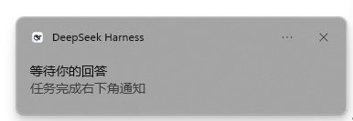

# DSH 任务完成通知

[English](README.en.md) | 简体中文

[DeepSeek Harness](https://github.com/deepseek-ai) 的客户端插件：每当一轮任务结束、会话向你提问、或等待你确认时，在**系统通知区域**（Windows 屏幕右下角）弹出一条通知。页面内不画任何东西，声音使用操作系统自带的提示音。



<sub>第一行是 Windows 显示的应用名，标题是状态，正文是会话名。</sub>

## 行为

| 时刻 | 通知标题 | 正文 |
| --- | --- | --- |
| 一轮运行结束 | 运行已结束 | 会话名 |
| 向你提问 | 等待你的回答 | 会话名 |
| 等待授权 | 等待你的确认 | 会话名 |

- 子代理会话保持安静，只有你自己驱动的会话会通知。
- 点击通知：窗口置顶并打开对应会话。
- 所有通知共用一个 tag，新状态替换旧通知，不会堆积。
- 首帧快照只作为基线，刷新页面不会重放历史事件。

## 安装

需要 DeepSeek Harness 0.2.2-rc.3（桌面版）。本插件是一个 Cordis bundle，从 npm 安装：

```text
plugin_manager → action: install_bundle → target: @jgeeee/dsh-task-complete-notifier@1.0.0
```

改插件源码开发时，也可以直接指向本目录（以 `link:` 方式装入 profile，改完刷新即加载新代码）：

```text
plugin_manager → action: install_bundle → target: <本目录的绝对路径>
```

安装后刷新页面即可生效。

## 实现说明

- 订阅 `shell.overlay` 槽位，从槽位注入的 `useSessionStatus` / `useSessions` 读取会话状态快照（DSH 客户端没有“任务完成”事件，只能比较快照）。
- 完成判定：`running` 由 `true` 变为 `false`。
- 提问/授权判定：`pendingInteraction.key` 与上一快照不同。
- 通知：`Notification` API，标题为状态、正文为会话名；仅在权限为 `granted` 时发送。
- 桌面壳会自动授予通知权限；普通浏览器在首次点击后询问一次，并用 `localStorage` 记住不再重复打扰。

> 客户端只暴露“是否在运行”，拿不到成功/失败，因此完成通知写“运行已结束”，不谎称成功。

## 已知限制

- 依赖 DSH `0.2.2-rc.3` 的客户端会话快照 API（内部契约），DSH 升级后可能失效。
- 通知权限被拒时不会退回页面内提示（这是有意的：只弹系统通知）。
- Harness 关闭期间结束的任务无法补报。
- 页面从未被点击/按键过时，浏览器/引擎可能不显示通知（自动播放与权限策略）。

## 许可

[MIT](LICENSE)
